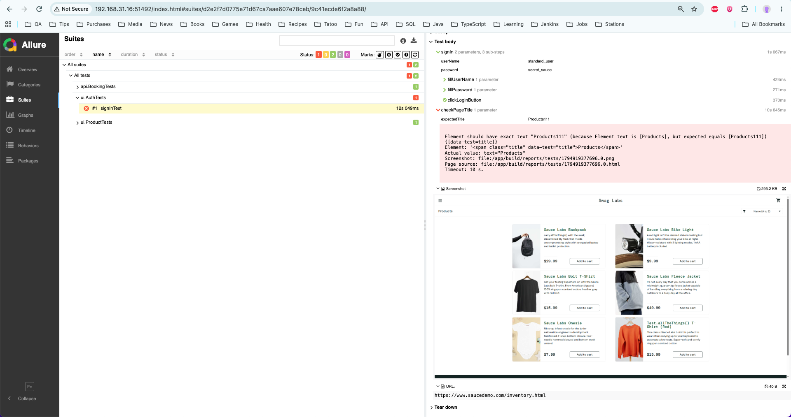

# QA Automation Framework

Automation testing framework built with **Java 17, Selenide, RestAssured, TestNG, Maven, and Allure**.

The project covers UI and API testing and supports both local and Docker execution.

## Prerequisites

The following tools are required for local execution:

- Java 17+
https://adoptium.net/temurin/releases/?version=17
- Maven 3.9+
https://maven.apache.org/install.html
- Google Chrome
- Allure Commandline (optional, for generating and viewing reports)
https://allurereport.org/docs/v2/install/

For Docker execution:

- Docker
https://www.docker.com/products/docker-desktop/

## Local Execution

Run tests from the project root directory.

### UI Tests

```bash
mvn clean test -Dsuite=UI
```

### API Tests

```bash
mvn clean test -Dsuite=API
```

### All Tests

```bash
mvn clean test -Dsuite=All
```

Or just run test class or test suite by TestNG (right click -> run)

### Allure Report

After test execution, generate and open the report:

```bash
allure serve allure-results
```
(if ui test fails → screenshot and url are attached to report)

Failed test example:


## Docker Execution

Docker Compose is used to run tests in an isolated environment.

The setup consists of two containers:

- **tests** — Maven-based container responsible for executing automated tests.
- **selenium** — Selenium Standalone Chrome container responsible for browser execution.

### Build and Run

```bash
docker compose up --build
```

The command builds the test image and starts both containers.

UI tests are executed remotely using Selenium WebDriver.

API tests run directly from the test container.

This is all tests run (All.xml suite)

Allure results are automatically mounted to the local `allure-results` directory.

### Stop Containers

```bash
docker compose down
```

### View Allure Report

After test execution:

```bash
allure serve allure-results
```

## Test Approach

### Locators

- Prefer stable attributes such as `data-test`, `data-testid`, and unique IDs.
- Use CSS selectors when they provide clear and maintainable element identification.
- Use XPath when more complex relationships or text-based identification are required.
- Avoid brittle selectors based on DOM structure or styling classes.

### Synchronization

- Use Selenide's built-in implicit waiting and condition-based assertions.
- Avoid hardcoded `Thread.sleep()` calls.
- Wait for expected element states rather than fixed time intervals.
- Use explicit API response validation where appropriate.

### UI/API Code Structure

UI:

- Page Object Model - encapsulate UI interactions.
- Steps classes - keep Page classes smaller by separating business actions.
- BaseStep class - helpful method for Steps
- BaseTest - setup tests flow
- BaseConfig - Selenide configuration
- CommonElements/CommonSteps - general components simple use

API:
- Service classes - encapsulate API requests.
- POJOs - request and response serialization/deserialization.
- Factories/builders - generate test data.
- BaseApi - configure base request template

Overall:
- TestListener - info about tests in runtime (started/finished etc)
- Keep test methods focused on test scenarios and assertions.
- Xml suite choose by parameter - ability to run any suite from console
